<div align="center">

# RP1 Test

**Module aging and whole-robot reliability testing for RP1**

Test rigs · PLC/CAN HMI · Test dashboard · Data archives and analysis

**English** · [简体中文](README_CN.md)

[Run the software](software/README.md) · [Build a rig](hardware/README.md) · [Test methods](test-cases/README.md)

</div>

RP1 Test brings test rigs, device control, recording and reliability data into one engineering project. Software 0.2.0 includes a React dashboard, PySide6 HMI, FastAPI and PostgreSQL. Hardware files cover arm, torso and leg-load rigs, alongside 18 whole-robot test methods.

| Arm rig and quick-release mounting | Torso rig | Leg-load rig |
| :---: | :---: | :---: |
| 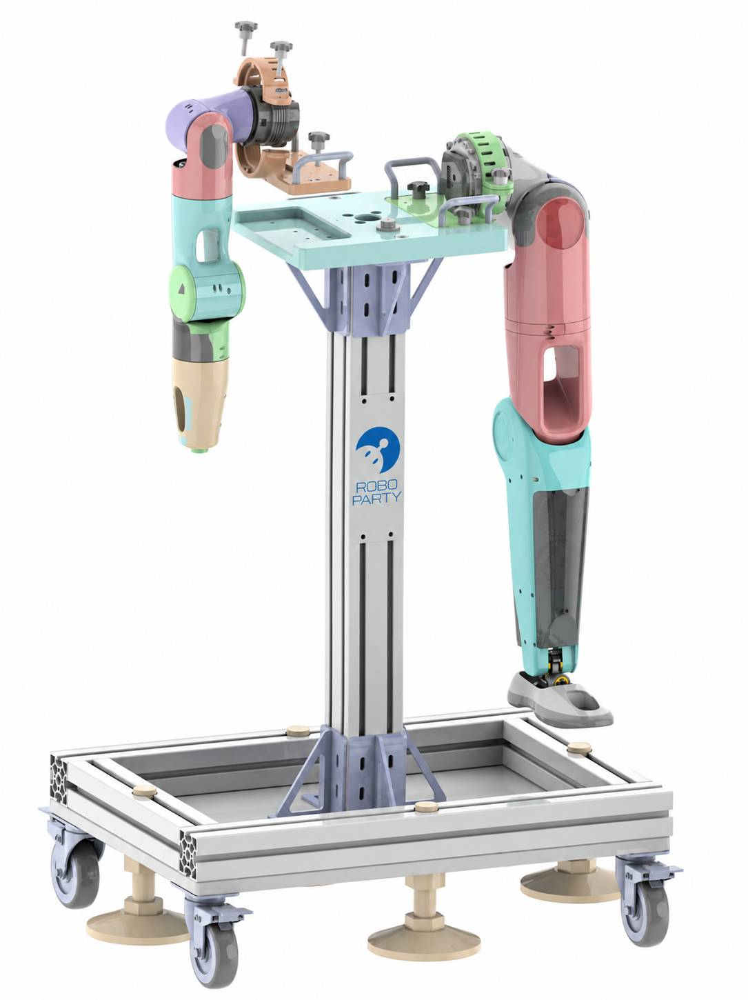 | 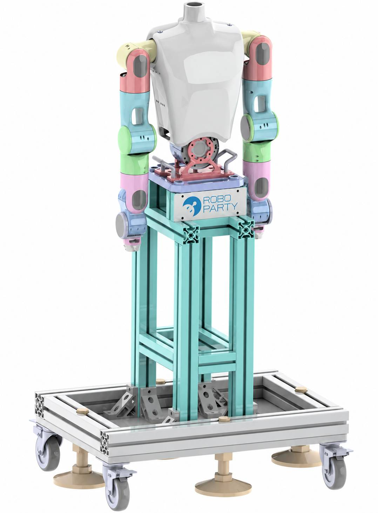 | 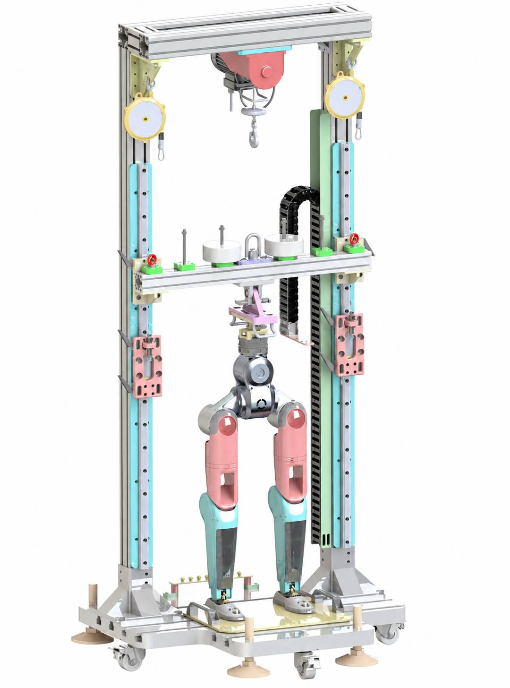 |

## Start Here

| Task | Entry point |
|---|---|
| Start the dashboard and reliability platform | [Software overview](software/README.md) · [Installation and operations](software/docs/operations.md) |
| Run or build the PLC/CAN HMI | [HMI source, mock mode and packaging](software/host/README.md) |
| Manufacture and assemble a rig | [Hardware overview](hardware/README.md) · [Mechanical files](hardware/mechanical/README.md) |
| Plan and record a test | [18 test methods](test-cases/README.md) · [Inspection and run record](test-cases/checklist.md) |
| View archives and curves | [Platform data workflow](software/docs/data-workflow.md) |

See the [documentation index](docs/README.md) for architecture, data workflows and development.

## Software in Action

### Test dashboard

Browse test cases, samples, execution status and runtime by module, with access to time ledgers, MTBF, station monitoring, archives and detailed curves.

| Arm module | Lower-body module |
| :---: | :---: |
| [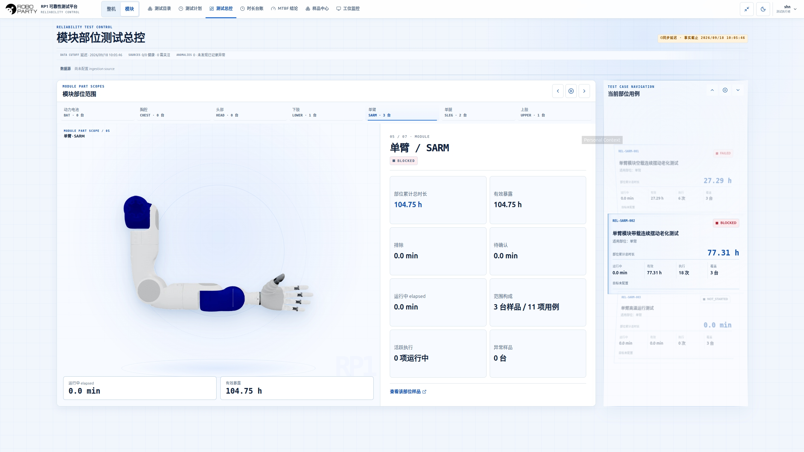](docs/media/showcase/arm-dashboard.jpg) | [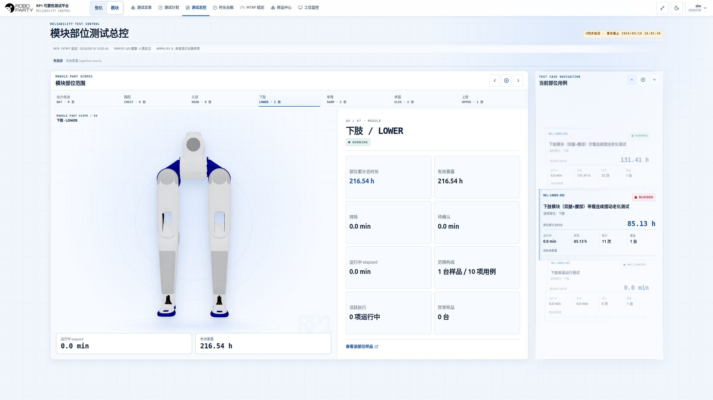](docs/media/showcase/lower-body-dashboard.jpg) |

### PLC HMI

The local gateway connects to PLC/CAN devices. The desktop provides test control, power and channel status, voltage/current trends, motor monitoring and local recording.

[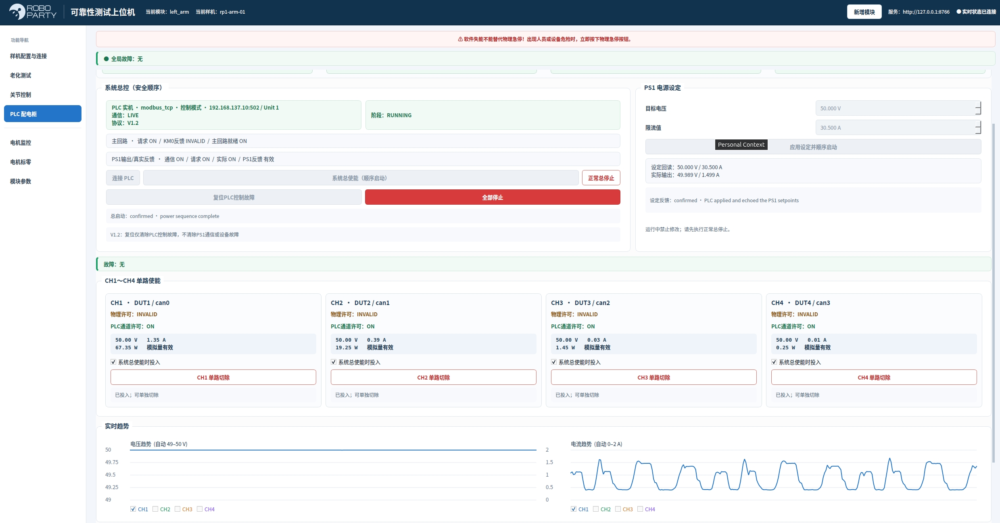](docs/media/showcase/plc-control.jpg)

| Aging-test workspace | Motor monitoring |
| :---: | :---: |
| [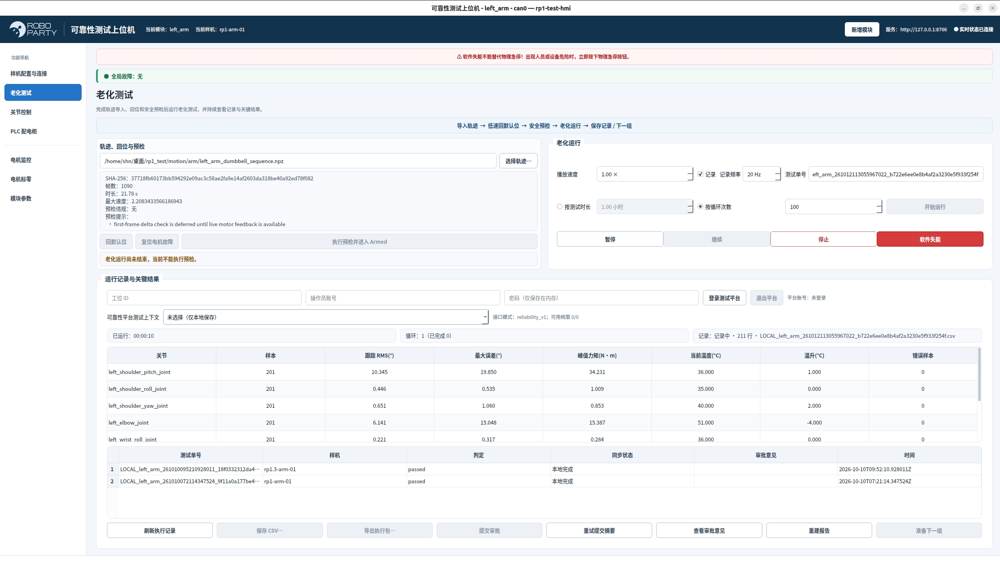](docs/media/showcase/aging-workspace.jpg) | [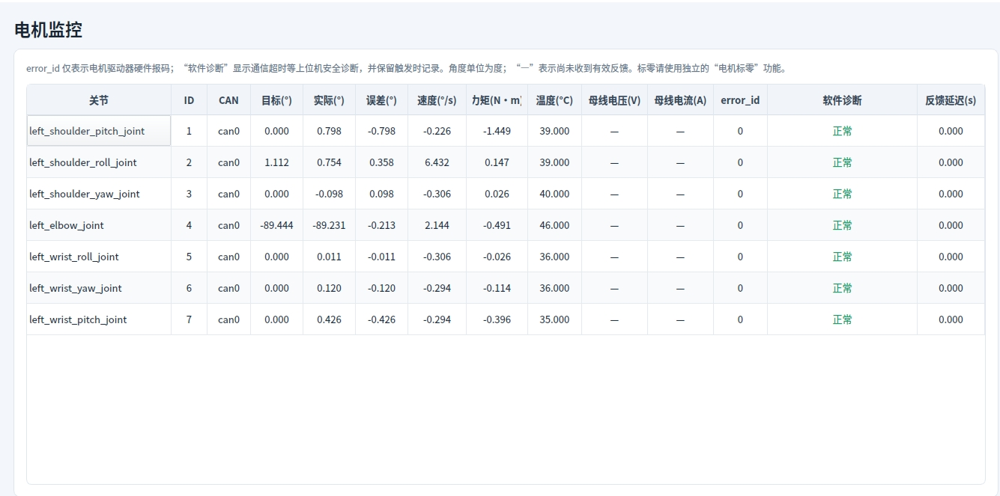](docs/media/showcase/motor-monitor.jpg) |

Select a screenshot to open its full-resolution image. The software also includes verified CSV archives, review and approval, browser-based history import, viewport curve queries and comparisons across executions. See the [software guide](software/README.md).

## Rig Demonstrations

### Arm loading

| 2.5 kg load | 3.5 kg load | 5.5 kg load |
| :---: | :---: | :---: |
| 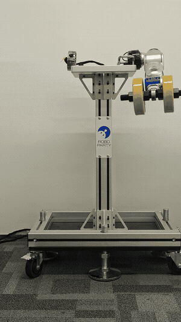 | 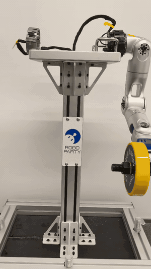 | 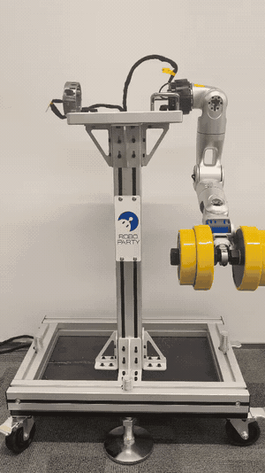 |

### Lower-body loading

| 50 kg load: stepping | 50 kg load: repeated rise |
| :---: | :---: |
| 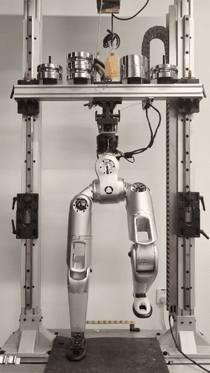 | 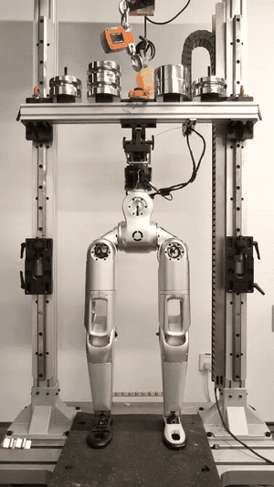 |

### Upper-body dynamic motion

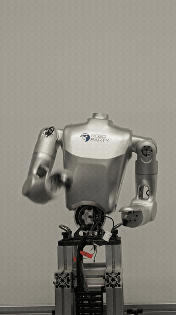

Animations are six-second excerpts at the original speed and aspect ratio. See the [media index](docs/media/README.md) for sources and asset details.

## Run the Software

On Ubuntu 24.04 amd64, prepare Docker Engine, Compose, Python 3 and OpenSSL:

```bash
cd software
python3 scripts/configure.py
bash scripts/up.sh
```

Follow the [setup guide](software/README.md) to trust the site CA and open the configured HTTPS address, defaulting to `https://localhost:8443`. The HMI has a dedicated mock mode; source startup and package builds are covered in the [HMI guide](software/host/README.md).

CSV files and reports are recorded locally first. After verification and explicit submission, files are archived centrally while the station retains its copy. Account permissions, live monitoring and test-data approval are separate workflows; see the [software entry point](software/README.md).

## Repository Contents

| Directory | Contents |
|---|---|
| [hardware/](hardware/README.md) | Rig models, manufacturing drawings, BOMs, electrical and assembly files |
| [software/frontend/](software/frontend/README.md) | React test dashboard and curve workspace |
| [software/host/](software/host/README.md) | PLC/CAN desktop, local gateway and build tools |
| [software/service/](software/service/README.md) · [database/](software/database/README.md) | API, central archives, workers, database and migrations |
| [test-cases/](test-cases/README.md) | Whole-robot methods, common rules and inspection records |
| [software/tools/test-runner/](software/tools/test-runner/README.md) | Optional trajectory, simulation and local recording tool |
| [Standalone telemetry demo](software/examples/telemetry-demo/README.md) | Synthetic InfluxDB/Grafana example |

For test preparation, see the [common rules](test-cases/common.md) and [parameter checklist](test-cases/open-items.md). Download the three Parasolid assemblies from [RP1_Test_Parasolid_CAD.zip](https://github.com/Roboparty/rp1_test/releases/download/v0.1.0/RP1_Test_Parasolid_CAD.zip); STEP files, drawings and BOMs are listed under [mechanical files](hardware/mechanical/README.md).

## License and Contributions

See [LICENSES.md](LICENSES.md) and [THIRD_PARTY.md](THIRD_PARTY.md) for material-specific licences and notices.

Contributions and corrections are welcome through an [issue](https://github.com/Roboparty/RP1_test/issues). Include the module or test-case ID, relevant file, and software/configuration version.
