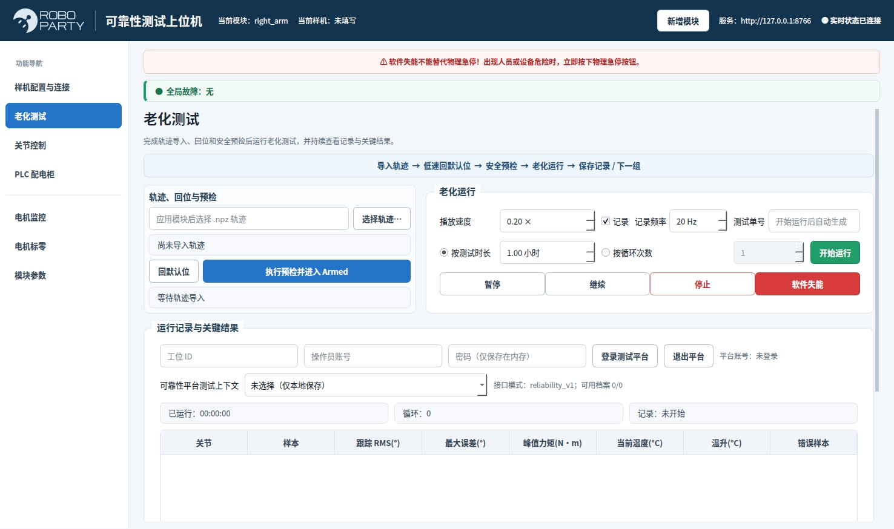
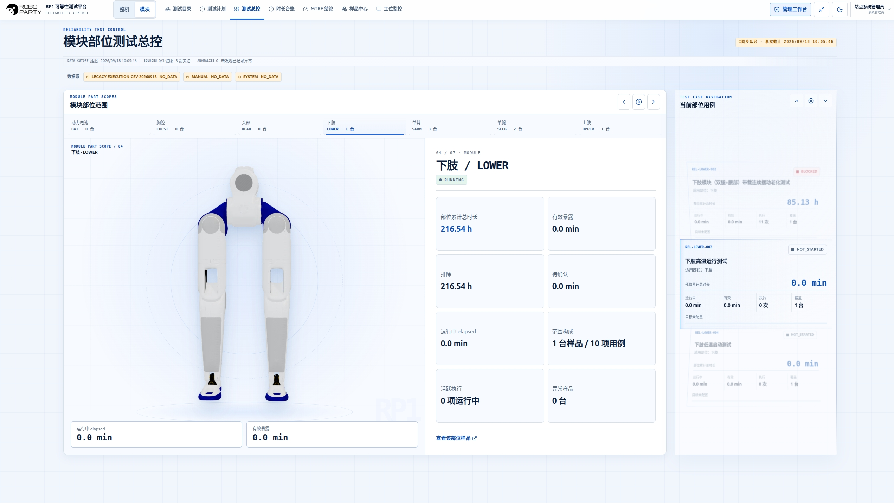
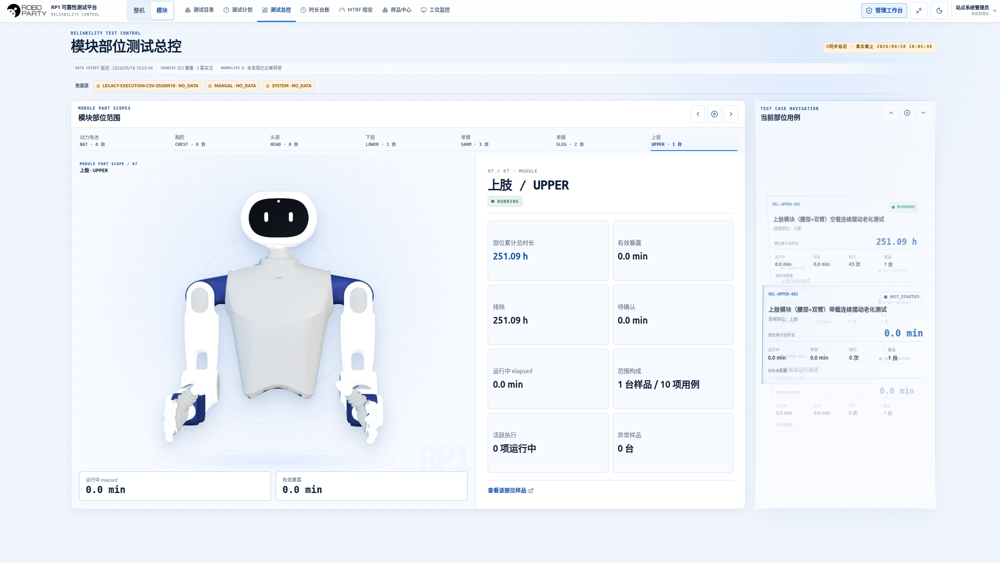
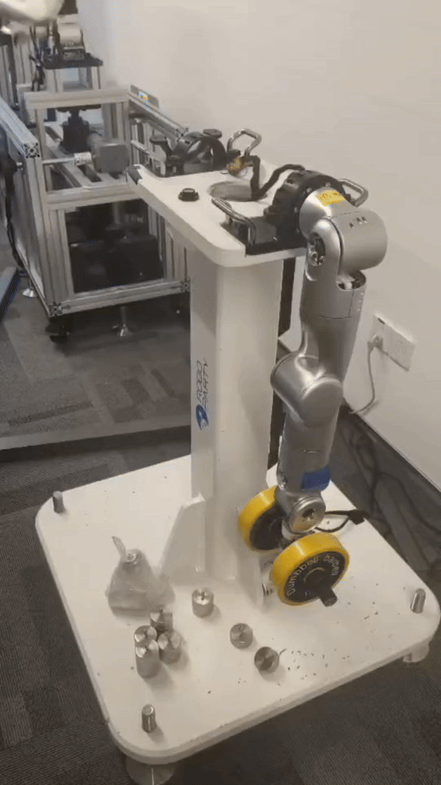

# RP1 Test

English | [简体中文](README_CN.md)

Test rigs, software and methods for RP1 module aging and whole-robot reliability testing. The repository includes arm, torso and leg-load rig files, RP1 Factory HMI, trajectory and data-collection tools, data services, and 18 draft whole-robot test methods.

## Start Here

| Task | Entry point |
| --- | --- |
| Run the software | [Factory HMI with the fake backend](software/host/README.md#快速开始) · [Data services and synthetic demo](software/README.md#快速开始) |
| Build a module test rig | [Hardware files and build guide](hardware/README.md) |
| Plan and record a test | [18 test methods](test-cases/README.md) · [Inspection and run record](test-cases/checklist.md) |

## Test Dashboards

| Lower body | Upper body |
| --- | --- |
|  |  |

Module-test control and summary dashboards from the companion platform.

## Rig Demonstrations

| Arm test | Leg test |
| --- | --- |
|  |  |

## Contents

- **Hardware:** manufacturing files and BOMs for module test rigs, plus a control-cabinet reference architecture.
- **Software:** desktop HMI, local control gateway, trajectory tools, FastAPI service, PostgreSQL, InfluxDB and Grafana.
- **Test methods:** 18 draft whole-robot methods with conditions, steps and record requirements.
- **Offline analysis:** a [standalone Python tool and worked example](data-analysis/README.md) for active time, tracking error, temperature, missing samples and events.

For test preparation and execution, see the [common rules](test-cases/common.md) and [parameter checklist](test-cases/open-items.md).

See [mechanical files](hardware/mechanical/README.md) for Parasolid assembly models, STEP part models, manufacturing drawings and BOMs. Download the three `.x_t` assemblies from [RP1_Test_Parasolid_CAD.zip](https://github.com/Roboparty/rp1_test/releases/download/v0.1.0/RP1_Test_Parasolid_CAD.zip).

## License and Contributions

See [LICENSES.md](LICENSES.md) for the scope of the software, hardware, documentation and third-party licences.

For a file error or a contribution, open an [issue](https://github.com/Roboparty/rp1_test/issues) with the module or test-case ID, relevant file, and configuration or software version.
