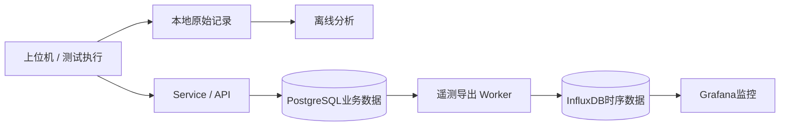

# 测试数据分析

围绕“机器人能否持续完成任务、试后是否退化、改进是否有效”整理分析方法与软件。输入来自上位机和测试执行记录，结果对应 [整机测试用例](../test-cases/README.md)，用于解释温升、跟随误差、任务中断和基线变化。

**本目录提供分析设计与数据接口说明。分析程序、示例文件和配置模板尚未实现。**

## 目录

| 目录 | 首版内容 | 输入 → 输出 |
|---|---|---|
| [docs](docs/README.md) | 架构、数据格式、采集、分析与接入指导 | 测试问题 → 指标、记录要求和解释方法 |
| [scripts](scripts/README.md) | 单次运行分析、基线对比、事件汇总 | 遥测、事件、配置 → 摘要、对比表和时间线 |
| [examples](examples/README.md) | 合成运行记录及预期结果；后续补匿名真实片段 | 可复现输入 → 可核对的分析结果 |
| [config](config/README.md) | 字段映射、运行区间、工况与阈值模板 | 原始字段 → 明确单位和统计范围的数据 |

分析输入采用 `rp1_test` 的 `telemetry.csv`、`events.jsonl`、`metadata.json` 和配置快照，并支持 Factory HMI 执行包的字段映射。任务里程、抓取结果、母线电压与电流需相应记录。

## 按用例使用

1. **选问题。** 001/003关注温升、误差与有效站立时间；002/016关注同路线和负载下的变化；012关注告警、降额、停机顺序；021关注成功、重试和人工接管。
2. **冻结条件。** 保存机器人、软件、负载、环境、任务目标、阈值和试前基线，具体规则见 [公共规则](../test-cases/common.md)。
3. **采集记录。** 通过 [上位机](../software/host/README.md) 和 [test-runner](../software/test-runner/README.md) 保存遥测、事件及确认的任务区间；标明暂停、换电、冷却与异常中断。
4. **分析与对比。** 跟随误差使用同工况的 active 样本；温度保留全程，包括暂停和停机后。用已确认的 active intervals 计算有效任务时长。
5. **形成结论。** 结合试前/试后检查、故障处置和复测记录，由执行者判断用例结果。脚本不自动生成正式 PASS。

## 与在线软件的关系

整体软件见 [software](../software/README.md)。Service 与 PostgreSQL 管理执行关联和业务汇总；InfluxDB 与 Grafana 提供遥测监控。离线分析按文件输入设计，无需部署全部服务。

## 分析约定

- 明确单位转换、缺失值、重复时间、暂停与中断的处理；缺失数据不填为 0，断采不计为正常完成。
- 输出记录输入来源、配置、统计区间和工具版本；可比条件不足时指出缺口。
- 示例阈值只演示软件行为；单次运行摘要不推导 MTBF，也不替代产品验收。
