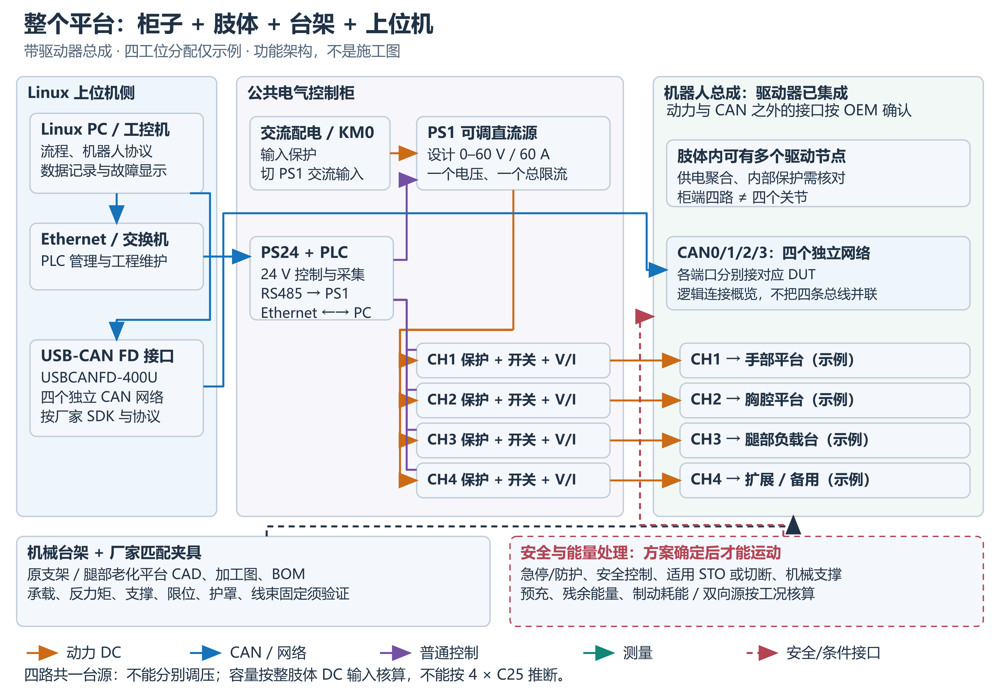

# 模块测试台架

[项目首页](../README_CN.md) · [软件](../software/README.md) · [测试方法](../test-cases/README.md)

提供手臂、胸腔和腿部负载三个台架的机械资料，以及配套控制柜的供电、通信和测量参考架构。适用对象为已集成驱动器的机器人总成。

## 资料入口

| 资料 | 入口 |
| --- | --- |
| 三类机械台架的 BOM 与加工资料 | [机械资料](mechanical/README.md) |
| 控制柜参考架构与系统采购表 | [电气资料](electrical/README.md) |
| 硬件搭建说明 | [阅读搭建说明](docs/hardware-build-manual.md) |
| 台架与机器人、控制柜的接口 | [机电集成](docs/integration.md) |

## 系统组成与搭建

搭建说明以 Markdown 为当前维护版，`docs/` 中的 PDF、Word 为原始参考版本。原文档的 MIT 授权继续保留，适用范围见[许可说明](../LICENSES.md)。

控制柜参考方案使用一台共用直流源：电压和总限流统一设置，四路支路独立通断并采集电压、电流。Linux 上位机经以太网连接 PLC 管理供电，经独立 USB-CAN / CAN FD 接口连接机器人。

控制柜 PLC 接口和机器人协议按目标设备适配与验证。

选择台架后，先核对安装接口、质量、重心、反力矩和运动包络，再按对应 BOM 与图纸准备机械组件。供电保护、回馈、重力支撑和安全停止按具体总成与工况设计，投用顺序见搭建说明第 10 节。

硬件设计、原创文档及第三方工程资料的适用范围见 [许可说明](../LICENSES.md)。
