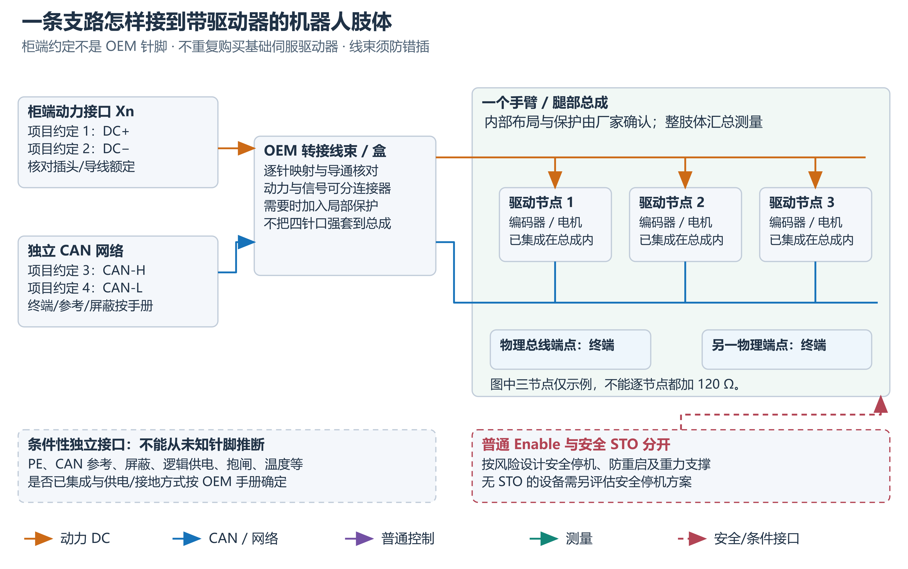
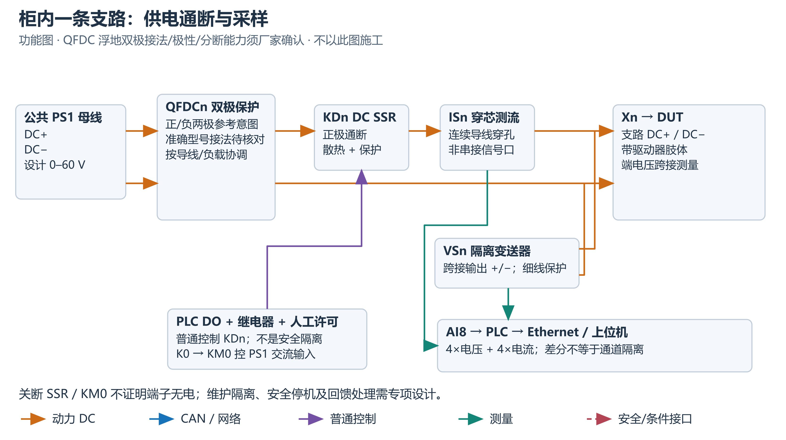

# 人形机器人模块测试平台
## 硬件搭建说明书 · 集成驱动器总成版

版本：1.0｜适用对象：集成驱动器的机器人总成｜用途：硬件设计、采购与集成

本平台由机械台架、测试控制柜、连接线束和 Linux 上位机组成。机器人手臂、胸腔或腿部固定在工装上，控制柜负责供电、分路通断及电压电流采集，上位机负责测试编排、机器人通信和数据记录。适用对象为已集成驱动器的总成，基础配置不另配关节驱动器。

电气部分采用 LFD835 V1.9 四通道参考架构。本文用于确定组件和集成关系；施工应配套原理图、端子与线束图，承载、保护、安全控制及能量处理应按实际总成和工况完成工程设计。涉及交流配电、功能安全或重力负载的工作，应由具备相应能力的工程人员实施。

### 已提供资料与施工范围

仓库包含机械 CAD、加工图和采购资料，以及控制柜功能架构、采购参考表和集成说明。未提供可直接施工的电气原理图、I/O 表、端子表、逐芯线束图及配套 PLC 工程；这些资料需在选定总成和器件后完成。配套软件提供 HMI、轨迹和数据服务，控制柜 PLC/电源接口仍需按实际工程适配与验证。

### 资料导航

| 文件 | 使用方式 |
|---|---|
| 本说明书 Markdown | 理解整个平台、建立采购与装配计划；PDF / Word 为未同步更新的原始参考版本 |
| platform-overview.svg / .png | 全平台硬件组成及连接总览 |
| limb-connection.svg / .png | 一个集成驱动器肢体如何接入与扩展 |
| channel-wiring.svg / .png | 柜内单通道供电、开关与采样关系 |
| electrical/system-bom.csv | 可编辑采购工作表；参考型号不等于最终下单规格 |

## 1. 平台硬件组成

完整平台分为六个部分：上位机、测试控制柜、柜外连接组件、机器人总成、机械工装，以及按风险设计的安全与能量处理装置。要进行精确力矩、效率、寿命曲线测试时，再添加加载与同步测量系统。

图 1：四个电气支路可分配给三个台架并保留扩展口，图中编号仅为示例，可从一个总成工位起步。不代表现有电源能同时满足多个总成的最大负载；真实支路和 CAN 端口映射以登记表为准。

| 部分 | 必须解决的问题 | 典型硬件 |
|---|---|---|
| Linux 上位机 | 柜子管理、机器人命令、测试编排与记录 | 工控机或 PC、以太网接口、USB 接口、数据存储 |
| 测试控制柜 | 交流转换为可调直流；四路供电通断和监测 | 保护器件、PS1、PS24、PLC、继电器、直流开关、传感器 |
| 柜外连接 | 把柜端接口正确转换到厂家肢体接口 | 动力线束、CAN 双绞线、转接盒、连接器、应力释放件 |
| 机器人总成 | 接受电源和通信，完成关节运动 | 已集成驱动器、编码器及内部线束的手臂/腿部 |
| 机械与防护 | 承受反力矩、约束运动并保护人员 | 底座、夹具、支撑、限位、防护围挡、线缆拖链 |
| 安全与能量 | 安全停机、防止坠落与母线过压 | 急停与安全控制、适用的 STO/切断元件、回馈耗能或双向电源 |

“能给肢体上电”不等于“可以安全运动”。动力、通信、工装、安全链和回馈处理需要共同完成，不能只接好 DC+、DC−、CAN-H、CAN-L 就开始运动试验。

## 2. 测试目标与采购范围

### 三个机械台架的仓库入口

| 平台 | 机械设计来源 | 接入与用途边界 |
|---|---|---|
| 手臂测试平台 | 共享总装与 LS75 手臂工装 | 手臂固定、供电、通信与支路采样；接口与承载按总成确定 |
| 胸腔测试平台 | 共享总装、胸腔框架与底板 | 胸腔固定与接口集成；腰部夹具、重心及布线空间单独匹配 |
| 腿部负载测试平台 | 腿部平台总装与机械 BOM | 腿部固定；加载机构、测量和能量处理按工况设计与配置 |

机械资料按“腿部 / 手臂胸腔”分组，各台架有对应 CAD、BOM 或加工图入口。手臂与胸腔共享一套总装及依赖资源；腿部平台采购使用工作表 `腿部老化测试平台 项目结构件 BOM`。BOM 按零件号和版本匹配模型，非台架采购工作表不纳入统计。装配文件及配套资源需保持相对位置，制造图和总装中性格式按加工需求准备。详见[机械台架](../mechanical/README.md)。

### 2.1 基础版本：通电、通信和电气老化

基础配置提供公共电源、KM0、四路独立通断、支路电压电流采集及机器人通信接口。公共电压/总限流设置、状态显示和老化记录由配套控制软件实现。一个支路连接整个肢体时，采到的是该肢体的总输入电流和支路端电压，不是每个关节的相电流或独立输入电流。

### 2.2 运动版本：增加工装、安全及回馈能力

驱动器上电后的使能、复位、模式选择、位置/速度/力矩命令及反馈，必须采用机器人厂家协议。测试柜的 Modbus TCP 不负责生成这些运动命令。重力负载需要机械支撑，抱闸释放前要确认姿态、支撑和控制条件。

### 2.3 性能版本：加载与独立测量

如果要测输出力矩、速度、效率、温升和耐久性，还需要扭矩传感器、加载装置、位置/速度测量及同步 DAQ。直流电子负载只能测试电源或电气支路，不能代替机械轴上的力矩加载。使用加载电机时，其驱动器、电源、控制和回馈路径是另外一套系统。

## 3. 总成接口与选型资料

先取得每个手臂/腿部的型号、硬件版本、接口图和通信协议，再冻结规格。缺失的内容在采购表中填写 TBD，不凭线色或其他机器人型号推断。

| 数据 | 对硬件选型的影响 |
|---|---|
| 允许的 DC 输入范围、欠压/过压阈值 | PS1 电压范围、保护阈值与电压传感器量程 |
| 整个肢体持续/峰值 DC 输入电流及持续时间 | 电源功率、支路保护、线径、连接器与散热 |
| 上电浪涌、总输入电容、允许上电顺序 | 是否增加预充、接触器或专用电源分配盒 |
| 减速/下放的最大回馈能量及驱动内部吸收能力 | 回馈耗能、制动电阻或双向源的容量 |
| 动力、通信、PE、屏蔽与参考地定义 | 转接线束和接地方案；不能把 DC−当作 PE |
| 内部节点数量、CAN/CAN FD 协议与终端配置 | 总线拓扑、节点 ID、速率与接口软件 |
| 逻辑/抱闸辅助供电及厂家使能接口 | 辅助电源、控制继电器或安全接口模块 |
| STO 或其他安全停机接口及限制 | 安全链设计；无 STO 时须另评估安全停机方式 |
| 总质量、最大关节力矩、运动范围与安装孔 | 工装、重力支撑、机械限位、防护空间 |
| 已集成的内部配电、保护及线束额定 | 是否还需要肢体端局部分配保护 |

填写一份接口清单对应一个总成版本；采购单、线束图、软件配置和测试记录使用同一版本号。四路都是同类型总成时可以复用模板，但仍应为每个实物记录序列号和节点配置。

## 4. 模块选型

### 4.1 柜内基础模块

以下为四通道配置的参考器件，采购时按实际应用确定规格。保护器件、继电器和功率开关的额定条件、短路容量、安装降额及兼容性必须在下单前核实；不能把“C25”或“60 A”铭牌单独当作整个系统的允许电流。

| 模块 | 参考器件 / 数量 | 用途及采购约束 |
|---|---|---|
| 进线与交流分支保护 | QF0 A9DC3625 ×1；QF1 A9F18225 ×1；QF24 A9F18206 ×1 | 交流输入与分支保护；现场电源、RCD 类型、短路能力和线缆协调需重新核算 |
| 主接触器 | KM0 LC1D25BD ×1 | 24 VDC 线圈；切断 PS1 的交流输入，不是 60 A DC 母线接触器 |
| 可调直流源 | PS1 6236-60-60 ×1 | 设计标称 0～60 V、60 A、3.6 kW；铭牌、交流输入和远程协议需核实；吸收回馈能力未确认 |
| 24 V 控制电源 | PS24 HDR-100-24N ×1 | 参考 24 V / 4.2 A；核算 PLC、传感器、继电器、通信及条件性辅助负载 |
| PLC | CPU 1214C G2，6ES7214-1AH50-0XB0 ×1 | 柜内普通控制和通信；不是安全 PLC |
| 模拟量模块 | SM1231 AI8，6ES7231-4HF50-0XB0 ×1 | 八路输入给四电压+四电流，已用满；差分输入不等于通道隔离 |
| RS485 板 | CB1241，6ES7241-1CA50-0XB0 ×1 | PLC 控制 PS1；由 PLC 背板供电，不另接一个外部 L+/M 电源口 |
| 中间继电器及底座 | RXM2AB2BD + RXZE1M2C ×5 套 | K0、K2～K5；驱动接触器/支路许可，核查线圈抑制与极性 |
| 支路直流保护 | QFDC1～4，A9N18225 ×4 | 参考 DC 双极 C25；具体电压、极性、分断能力与隔离功能待供应商确认 |
| 直流固态开关 | KD1～4，ZTP-60DD ×4 | PLC/人工许可下通断动力正极；匹配散热器及保护；不作为安全隔离装置 |
| 电流变送器 | IS1～4，VD-D14-15 ×4 | 参考 0～50 A → 0～10 V，24 V 供电；单向量程不能完整观察负向回馈 |
| 电压变送器 | VS1～4，VD-D13U 定制 ×4 | 目标规格 0～100 V → 0～10 V；逐通道按实际订货量程配置、换算与校准 |
| CAN FD 接口 | ZLG USBCANFD-400U ×1 | 四个 CAN FD 网络接口接 Linux USB；核对 SDK、Linux 架构及驱动支持 |
| 端子、母线与 PE | 正/负动力分配、24 V/0 V 分配、PE 排 | 额定电流、线径、接线容量、温升及标识须满足设计 |
| 操作与指示 | 四路人工许可、灯塔、控制复位、柜体附件 | SRESET 用于控制电源复位，不是急停；H0 细支线需匹配保护 |

HDR-100-24N 的规格应按厂家版本核对，不与 HDR-100-24 混用。[Mean Well 数据表](https://www.meanwell.com/Upload/PDF/HDR-100/HDR-100-spec.pdf)。CPU 与 AI 的能力边界见 [Siemens CPU 通信规格](https://docs.tia.siemens.cloud/r/simatic_s7_1200_g2_manual_collection_enus_20/technical-specifications/cpu-1214c/communications) 和 [SM1231 AI8 规格](https://docs.tia.siemens.cloud/r/simatic_s7_1200_g2_manual_collection_enus_20/technical-specifications/analog-signal-modules-sms/sm-1231-ai-8x14bit)。

### 4.2 柜外必须准备的硬件

| 硬件 | 四工位示例数量 | 选型要点 |
|---|---|---|
| Linux PC / 工控机 | 1 台 | 稳定以太网与 USB；核对 CAN SDK 运行环境；存储测试日志 |
| 以太网交换机 | 1 台，按网络布局需要 | 让上位机与工程电脑同网段接 PLC；端口数、工业环境与供电匹配 |
| Ethernet / USB 线缆 | 按布置 | 不依靠悬挂的 USB 插头承受拉力；运动范围内线束需机械固定 |
| 柜到肢体动力线束 | 4 套 | 最大电流、长度、压降、弯曲寿命、连接器额定与防错插 |
| 柜到肢体 CAN 线束 | 4 套 | 阻抗匹配的屏蔽双绞线；检查两端终端、参考线与屏蔽方案 |
| 厂家端转接连接器/盒 | 4 套 | 必须按 OEM 针脚图；禁止通用四针口直接套用肢体针脚 |
| 肢体固定工装、支撑与防护 | 每工位 1 套 | 承载、反力矩、惯性、坠落、夹挤点和运动包络 |
| 电缆夹、护套、拖链、标签 | 按长度与工位 | 转接盒与插头两侧做应力释放；高电流端子防触碰 |

若只是单工位验证，先采购一套匹配的线束和工装。四路结构通过验证后再复制，避免四套线束同时按错误针脚制作。

### 4.3 条件性模块和运动试验必需的评估项

| 模块 | 何时需要 | 不能省略的判断 |
|---|---|---|
| 肢体端配电与局部保护盒 | 总成内部没有适当分配保护，或外接多个关节 | 柜端保护不自动保护内部更细的分支线和插头 |
| 预充模块 | 输入电容/浪涌超过源、SSR或插头承受能力 | 预充电阻能量、旁路器件、时间与失败诊断 |
| 回馈处理模块 | 工况可能向 DC 母线回送能量 | 驱动内部吸收、耗能电阻或双向源必须有容量证据 |
| 逻辑/抱闸辅助电源与控制 | 总成另有此类接口 | 厂家指定电压、容量、时序、抑制与安全限制 |
| 安全继电器/安全控制器、急停、安全切断元件 | 按风险评估形成的运动安全方案 | 所需性能等级、停止方式、反馈监控与验证；不能用普通 PLC 替代 |
| PE/CAN 参考等附加连接器 | OEM 要求但柜端四针口不包含 | 独立规划，不能借用未知屏蔽层承担保护或返回电流 |
| 额外传感器与 DAQ | 温度、力矩或同步波形测量 | 八路 AI 已占满；同步性、采样率、隔离及量程 |

采购清单中的“条件性”不表示运动安全措施可以任意不装，而表示必须由 DUT 与工况确定具体实现。没有完成安全和回馈判断，不开放运动试验。

## 5. 柜端与机器人总成连接

图 2：一个支路供一个肢体。总成内部的多个驱动节点共享厂家规定的电源/通信布局，内部功能以 OEM 实物为准；如需外部局部配电盒，应独立设计。STO、抱闸、PE、逻辑供电并非每个总成都提供同样接口。

### 5.1 柜端四针口的含义

柜端接口 X1～X4：1=DC+、2=DC−、3=CAN-H、4=CAN-L。这仅是柜端项目约定，不是通用机器人接口。连接前必须把它转换为该肢体厂家明确规定的针脚；动力和信号触点的电流、电压、插拔顺序与防护须分别验证。若一个混合四针连接器不满足大电流、安全或 EMC 要求，改用分开的动力与通信连接器。

| 连接 | 从哪里到哪里 | 工程要求 |
|---|---|---|
| 动力正/负 | 支路输出 → 肢体 DC 输入 | 正负不反接；连接器和导线共同满足持续/峰值电流、压降及浪涌 |
| CAN-H/L | 独立 CAN 网络 → 肢体 CAN 接口 | OEM 协议、速率、ID 与终端设置一致 |
| PE | PE 系统 → 需要保护接地的金属部件 | 按设备类别与厂家要求；动力负极不能代替 PE |
| CAN 参考 | CAN 设备参考 → DUT 指定参考端 | 仅按两端手册；隔离域、共模范围与接地环路需评估 |
| 屏蔽 | 线缆屏蔽 → 指定屏蔽端/夹 | 作为 EMC 路径，不默认作为信号参考或保护导体 |
| 辅助电源 | 匹配电源 → 逻辑/抱闸端 | 明确额定、隔离、返回线、熔断与控制时序 |
| 安全/使能 | 安全控制或普通控制 → OEM 相应接口 | 区分普通 Enable 与经认证 STO；不能互相替代 |

### 5.2 多关节总成的内部连接

每个手臂/腿部可能含多个驱动节点。四路供电不是四个关节，也不是最多四个 CAN 节点。节点总数由 OEM 协议、总线负载及接口能力决定。同一 CAN 总线中节点 ID 应唯一，拓扑以主干线及受控短支线为原则；高速 CAN/CAN FD 只在两个物理总线端点设置规定的终端，不在每个关节重复添加 120 Ω。[TI 终端参考](https://www.ti.com/tool/TIDA-01238)、[NI CAN 物理层指南](https://www.ni.com/en/support/documentation/supplemental/09/can-physical-layer-and-termination-guide.html)。

CAN 接口和肢体内部的终端电阻均应计入总线终端配置。总线长度、分支、节点数及 CAN FD 数据阶段速率应匹配。

### 5.3 线束制作清单

一套肢体线束应交付：两端连接器型号和视图方向、逐针映射、线径/长度、动力与信号区分、PE/参考/屏蔽处理、压接工艺、防错插方式、额定与测试记录。标记示例 CH1-PWR、CH1-CAN、CH1-AUX、CH1-SAFE；线色只是辅助标识，针脚表和导通检查才是依据。

制作后在断电条件下检查导通、短接、正负与 CAN 极性、屏蔽意外搭接及连接器应力释放。绝缘试验方法须先确认不会损坏电子设备；不要对已经连接驱动器、PLC 或 CAN 接口的线束随意进行高压测试。

## 6. 柜内供电、开关与采样

图 3：功能连接图，不替代端子、线号、保护及接地施工图。正极经 SSR 和电流传感器穿线后到负载；电流传感器不串入模拟量端，电压变送器跨接在支路输出端。

### 6.1 交流和控制供电

交流输入经 QF0 后分两路：QF1 → KM0 → PS1；QF24 → PS24，控制与采集从 24 V 电源供电。PE 不经开关，连接柜体、柜门、安装板和设备要求的保护接地点。KM0 切断的是 PS1 交流输入，电源输出电容及 DUT 电容可能仍保存能量，所以 KM0 断开不等于 DC 端立即无电，也不等于可检修的隔离状态。[KM0 厂家数据表](https://iportal.se.com/Contents/docs/SQD-LC1D25BD.PDF)。

SRESET 的功能为复位控制供电，并非总隔离或急停。复位后传感器、部分通信及动力侧可能仍有电；隔离、验电和残余能量释放应采用专门的维护流程。

### 6.2 公共母线和四个支路

PS1 输出进入正、负分配端子。支路设计采用正、负两极经 DC 双极保护器的架构；正极再经过 KDn 固态开关和 ISn 穿线，连接到 DUT，负极返回相应支路。该保护器是否允许所需浮地双极接法、极性、分断与隔离能力，须由厂家资料确认后才能实施。每路 VSn 测量下游输出电压。BUS48 是公共动力母线标识，不表示输出电压固定为 48 V。

PLC 输出控制 K0、K2～K5；K0 许可 KM0，K2～K5 和各路人工许可共同控制 KD1～KD4。支路许可是普通控制逻辑，不等于已证明负载带电；断路器位置、人工开关、SSR故障和连接器状态都可能影响实际供电。

SSR 存在关断漏电、失效短路及散热条件，不能当作检修隔离或单独安全停机装置。其铭牌电流需按安装温度、散热和保护条件解释。[Omron SSR 安全注意](https://www.ia.omron.com/product/cautions/18/safety_precautions.html)。

### 6.3 测量链和量程

四路电压、四路电流经变送器变成 PLC 可接受的低压信号后进入 AI8。机器人动力电压不能直接接 AI 口。变送器输入侧、输出侧和辅助电源之间的隔离能力要以准确型号的数据表为准；AI8 自身不是八个相互隔离的输入。

| 通道 | 项目参考 PLC 地址 | 目标换算 / 状态 |
|---|---|---|
| VS1、VS2、VS3、VS4 | IW96、IW98、IW100、IW102 | 按实际变送器量程换算；100 V 满量程与 27648 满量程原始值配套时，系数为 100/27648 |
| IS1、IS2、IS3、IS4 | IW104、IW106、IW108、IW110 | 参考 0～50 A / 0～10 V；0～10 V 正常标称满量程为 27648 |

地址只适用于该参考项目，复制到新硬件组态后必须重新核对。AI 电压量程按 Siemens 支持范围和分组限制配置；零点、符号、断线/越界与有效性单独记录，不以“显示 0”代替有效信号。

每路传感器的量程、硬件组态、软件换算和通信编码应一致。基础换算不引入无校准依据的固定补偿；如需零点或增益修正，应由校准数据确定，并与传感器及配置版本关联。

## 7. 电源容量：四个支路不能当作四台电源

四路共用 PS1，因此只有一个输出电压设定及一个公共总限流。四路可以独立通断，不能同时设置四个不同电压，也没有四个独立可编程电流限值。不同额定电压的手臂与腿部不能简单挂在同一母线上；需要独立电源域或经验证的专用转换方案。

### 7.1 核算方法

每个肢体的输入电流取厂家提供或经过验证的 DC 输入数据，不用电机相电流直接相加。先确定同时运行的工况，再计算：

- 肢体支路持续电流 = 该肢体内部各节点在指定工况下的 DC 输入电流合计。
- 母线持续电流 = 同时运行肢体的 DC 输入电流合计，并计入必要裕量与环境降额。
- 电源输出功率 = 母线电压 × 母线电流；峰值还要核对持续时间和源的动态能力。
- 24 V 容量 = PLC、AI、传感器、继电器、CAN 等负载合计；外加抱闸不能默认挤入现有电源。
- 交流容量 = 按 PS1 效率、功率因数、输入电流与浪涌核算，并协调进线、插座和保护。

参考源在 48 V × 60 A 时为 2.88 kW，60 V × 60 A 时为 3.6 kW；这些只是标称乘积，不代表现场进线可以连续承载。3.6 kW / 220 V 已约为 16.4 A，尚未计损耗与功率因数，因此不能使用普通 16 A 插座作为默认满功率进线方案。

### 7.2 一个用于说明的容量例子

假设某肢体有 6 个驱动节点，每节点 DC 输入持续 5 A，则该肢体合计 30 A；四个相同肢体同时达到该工况就是 120 A。这是容量算例，不代表具体机器人参数，超过参考 60 A 公共源，也超过参考 C25 支路的名义电流。解决方法是降低经过验证的同时运行负载，或重选电源、配电、保护、线缆与开关，不能仅把断路器换大。

支路线径应按电流、长度、敷设、环境温度、压降、连接器与短路保护共同确定。参考配置的 16 mm² 主干、4 mm² 支路用于方案比较，不是所有肢体和长度的统一推荐。

100 V 电压传感器的作用是测量更大量程，不会把 60 V 电源、SSR、保护和连接器升级成 100 V 动力系统。

## 8. 回馈、制动与接地

| 项目 | 要求 |
|---|---|
| 回馈处理 | 按功率、能量、阈值及温升匹配吸收装置，协调预充、放电、制动和切断顺序。 |
| 抱闸 | 核对厂家规定的电压、线圈电流、保持转矩及释放/吸合时序；用途按厂家规定。 |
| 停机与防坠 | 急停、联锁及适用的 STO/动力切断独立设计并验证，包含执行元件反馈；重力负载设机械支撑，进入前隔离并处置残余能量；恢复供电、网络重连或解除急停后须重新授权启动。 |
| 接地与屏蔽 | PE、DC−、控制 0 V/M、CAN 参考和屏蔽按图纸及两端手册连接，分别核对隔离域、接地和屏蔽端接。 |

## 9. 上位机与 PLC、机器人通信

### 9.1 到 PLC：以太网管理供电

Linux PC → 以太网 → PLC，参考使用 Modbus TCP，PLC 作为服务器。程序负责设定公共电压/电流限制、主接触器及四路请求，读取支路 V/I 和控制状态。工程电脑可通过交换机接入同一网络维护。Modbus 客户端数量、PLC 连接资源、IP 与网卡路由应按软件和设备配置确定。该 CPU 的两个 RJ45 属于同一集成交换式 PROFINET 接口，不当作两个独立网段。

PLC、Linux PC 和工程电脑应使用唯一 IP 地址和规划一致的子网；多网卡避免重叠子网造成路由冲突。控制网络应与公网隔离。

### 9.2 到机器人：USB-CAN/CAN FD

Linux PC → USB → USBCANFD-400U → 各肢体。CAN 接口不经过 PLC 的 Modbus 数据通道；机器人厂家协议、帧定义、节点 ID、模式、限位、超时和复位由上位机机器人控制部分实现。

厂家产品页列有 Linux 支持，但不表示任意 Linux 架构或 SocketCAN 可直接使用。采购前核对 SDK 版本、CPU 架构、内核、权限、示例程序和 CAN FD 模式，并在目标电脑验证枚举、发送、接收与错误计数。[ZLG 产品资料](https://www.zlg.com/can/can/product/id/223.html)。

### 9.3 软件状态不能替代实物确认

上位机要区分“请求通电”“PLC 许可”“接触器反馈”“传感器实测带电”“机器人驱动已使能”。分别展示与记录，避免用一个绿灯覆盖所有状态。母线电压正常也不证明每个驱动无故障；CAN 在线不证明机械安全。

采用无符号 16 位 mV 编码时，最大可表示电压为 65.535 V。0～100 V 测量应采用足够的位宽或明确的定标，并同步 PLC 编码与 Linux 解码，不能只修改传感器换算系数。

测量接口应定义有效位、采样时间或递增计数、质量和失效状态。缺少这些字段时，不能仅由最后一个数值判断数据新鲜度。`CommReady` 等端口就绪标志与 `Permit` 等软件许可，均不等同于从站健康或负载实测带电。

## 10. 装配与投用条件

装配顺序从接口定义和断电安装开始，再逐步进入单工位与多工位集成。各阶段应满足相应工程条件，由具备能力的人员实施。

| 阶段 | 工作内容 | 投用条件 |
|---|---|---|
| 0. 定义 DUT | 收集厂家接口、电源、通信、回馈及机械数据 | 参数表有来源，缺项明确；采购规格可冻结 |
| 1. 完成设计 | 原理图、BOM、I/O、线束、工装、安全及能量方案 | 电气/机械审查完成，施工与测试责任明确 |
| 2. 断电装配 | 柜体、器件、接地、端子、动力/信号分区及线束 | 标签与图纸一致，导通/极性/保护连接检查通过 |
| 3. 控制层验证 | 由授权人员按计划验证 24 V、PLC、AI、通信与继电器 | 无意外吸合，电源容量和启动状态符合设计 |
| 4. 单路电气验证 | 用匹配的安全假负载核查源、保护、通断及采样 | 测量与参考仪表一致；温升与切断行为符合计划 |
| 5. 总成静态接入 | 机械固定；按 OEM 流程连接；运动保持禁止 | 正确节点与反馈、供电稳定、无异常故障 |
| 6. 单肢体受控运动 | 安全链、支撑、回馈方案通过后执行限定工况 | 停机、防重启、能量与机械约束验证通过 |
| 7. 多工位扩展 | 核算公共源、CAN负载、温升与互相影响 | 不超容量，故障响应明确，形成整个平台 FAT 记录 |

从“一个柜支路 + 一个肢体 + 一个工装”开始集成，再按容量与安全要求扩展。控制接口应明确定义启动、失联、PS1 通信或设备故障、恢复供电与网络重连时的输出状态；恢复连接不得自动恢复运动。温升、停机、采样准确度和工位相互影响属于投用条件。

### 每个工位应留下的资料

DUT 型号与序列号、固件、线束图、节点列表、终端矩阵、工装图、负载工况、限值、测量校准记录、安全验证记录，以及每次试验的时间、版本、故障和原始数据。维修换件或传感器改量程后更新版本与验证记录。

## 11. 适配与维护

仓库提供硬件架构、机械资料、BOM 和集成说明。PLC 工程、Linux 控制程序及机器人运动协议应与所选器件、固件和 OEM 接口配套，不由机械模型或架构图替代。

每种总成的适配资料应包含安装接口、动力与辅助电源针脚、CAN 配置、允许工况、回馈与预充要求、传感器量程和测量编码。更换总成、传感器或控制软件时，更新相关配置与校准参数。

采购以对应型号的数据表、原理图、加工图与采购表为依据。文档、硬件设计及第三方资料的适用许可见 [许可范围](../../LICENSES.md)。
