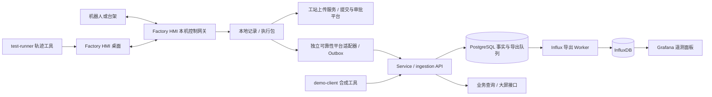

# 测试软件与部署

提供 RP1 Factory HMI 桌面上位机、测试执行工具、可靠性数据 API 和监控服务。设备控制在机器人旁的本机网关执行；数据通过 Service 进入 PostgreSQL 和 InfluxDB，由 Grafana 展示。

## 快速开始

需要 Docker Engine、Docker Compose 和 Python 3。以下命令在 `software/` 下运行：

```bash
sh scripts/start.sh
sh scripts/run-demo.sh
python3 scripts/verify_stack.py --demo
```

首次启动生成私有 `.env`，完成数据库迁移、InfluxDB 初始化和面板导入。`demo-client` 生成 **12 秒时间跨度、10 秒有效任务时间、2 秒暂停** 的双关节记录，经 API 上传，再由 Worker 导出至 InfluxDB。数据始终标为 `synthetic`，测试结果为 `INCONCLUSIVE`。

桌面上位机见 [RP1 Factory HMI](host/README.md)，桌面客户端与本机控制网关分别启动。上述命令启动数据服务并运行 `demo-client` 合成示例。

| 入口 | 默认地址 |
|---|---|
| Service 文档 | <http://127.0.0.1:18080/docs> |
| Service 就绪检查 | <http://127.0.0.1:18080/readyz> |
| Grafana | <http://127.0.0.1:13000/d/rp1-joint-telemetry> |
| InfluxDB | <http://127.0.0.1:18086> |
| PostgreSQL | `127.0.0.1:15432` |

登录账号与本地生成的密码见 `.env`。端口可在该文件调整。演示记录和 SQLite 补传队列保存在 `.runtime/`；凭据、运行记录与容器卷均不属于公开源码。

```bash
sh scripts/stop.sh  # 停止服务，保留数据库与遥测卷
```

Compose 项目名为 `rp1-test`，使用独立端口和卷。重新运行 `run-demo.sh` 会更新演示采集凭据并创建一次新运行。

## 目录与阅读顺序

| 模块 | 功能 | 代码入口 |
|---|---|---|
| [host](host/README.md) | RP1 Factory HMI：桌面、控制网关、CAN、监控/标零、回放、报告与上传 | `factory_hmi/desktop/` → `gateway/` → `core/` → `sync/` |
| [test-runner](test-runner/README.md) | 轨迹生成/校验、dry-run、仿真及硬件回放、保护门控 | `cli.py` → `commands/` → `hardware.py`、`artifacts.py` |
| [service](service/README.md) | FastAPI、采集协议、身份权限、业务查询、汇总与导出 Worker | `app/main.py` → `api/routes/` → `services/` → `repositories/` |
| [database](database/README.md) | PostgreSQL 结构、有序迁移、用例导入、合成演示上下文 | `alembic/versions/`、`sql/`、`seeds/` |
| [influxdb](influxdb/README.md) | HTTP 初始化、字段合同、写入/查询与合成样例 | `schema/telemetry.md`、`scripts/` |
| [grafana](grafana/README.md) | 数据源、面板 JSON、provisioning 与校验 | `dashboards/joint-telemetry.json`、`provisioning/` |
| [demo-client](demo-client/README.md) | 合成采集与 ingestion 补传演示 | `src/rp1_demo/cli.py`、`demo.py`、`platform.py` |

公共部署位于 `compose.yaml`；启动、演示和诊断命令集中在 `scripts/`。离线分析见 [data-analysis](../data-analysis/README.md)。

## 数据怎样流动



PostgreSQL 保存用例、配置、执行、事件和降采样遥测。API 在同一事务内保存遥测与 Influx 导出任务；Worker 写入成功后确认任务，失败后保留并退避重试。InfluxDB 用于过程曲线，原始采样以本地运行记录为准。

Grafana 提供温度、指令/反馈、跟踪误差、速度、力矩及数据来源显示。Service 提供业务查询接口，可用于自定义大屏；故障事件标注尚未接入面板。

Factory HMI 支持工站登录、提交审批和分块上传协议；本仓库的 Service 提供可靠性 `ingestion` 协议。[执行包桥接](host/docs/RELIABILITY_BRIDGE.md)用于接入可靠性数据，不提供审批功能。HMI 的可选直接实时写入使用 InfluxDB 3 API；Compose 通过 Worker 写 InfluxDB 2.9，配置时须选择对应协议。

## 共同约定

| 信息 | 约定 |
|---|---|
| 运行身份 | 本地 `run_id` 对应稳定 producer key；API 返回平台 `execution_id`，Influx `run_id` 使用该 UUID |
| 单位 | 本地 rad、rad/s；采集端显式转换为平台及面板的 deg、deg/s |
| 时间 | UTC 起止与相对时间同时保留；`precision=ns` 是写入格式，平台时间精度仍为原始微秒 |
| 有效运行 | 使用确认的任务区间；暂停和非计划停机分别记录，不能按 CSV 末时间自动认定 |
| 缺失值 | 不将 NaN、空值转换为 0；未采集的电流、电压、IMU 或振动不补造 |
| 数据来源 | `synthetic` 与 `real` 显式区分；程序完成不自动等于用例通过 |
| 原始附件 | API 当前登记路径和校验信息，文件仍在采集端；未实现对象存储上传 |

RP1 Factory HMI 使用 PySide6 桌面与本机控制网关，负责 CAN、电机保护和轨迹回放；`test-runner` 提供独立轨迹与执行工具。真机 `motors_py`、台架驱动和验收判据按实际设备接入。环境箱、振动台、跌落和人工检查等步骤需要对应设备与人员执行。

## 开发与诊断

```bash
# 本地部署与最新演示的实际 Influx/Grafana 查询
python3 scripts/verify_stack.py --demo

# 后端单测；挂载数据库合同用于跨模块检查
docker compose run --rm --no-deps -v "$PWD/database:/database:ro" api python -m pytest -q

# 数据库导入逻辑与实际结构
docker compose run --rm --no-deps migrate python -m unittest discover -s tests
docker compose run --rm migrate python scripts/verify_schema.py

# 面板与字段合同（不需要启动服务）
python3 grafana/scripts/validate_dashboard.py
python3 -m unittest discover -s influxdb/tests
```

测试工具与上位机的安装和单测命令见各自 README。诊断脚本默认等待异步导出最多 30 秒。合成示例用于说明软件使用；机器人可靠性结论来自按用例执行的实测与复测。
